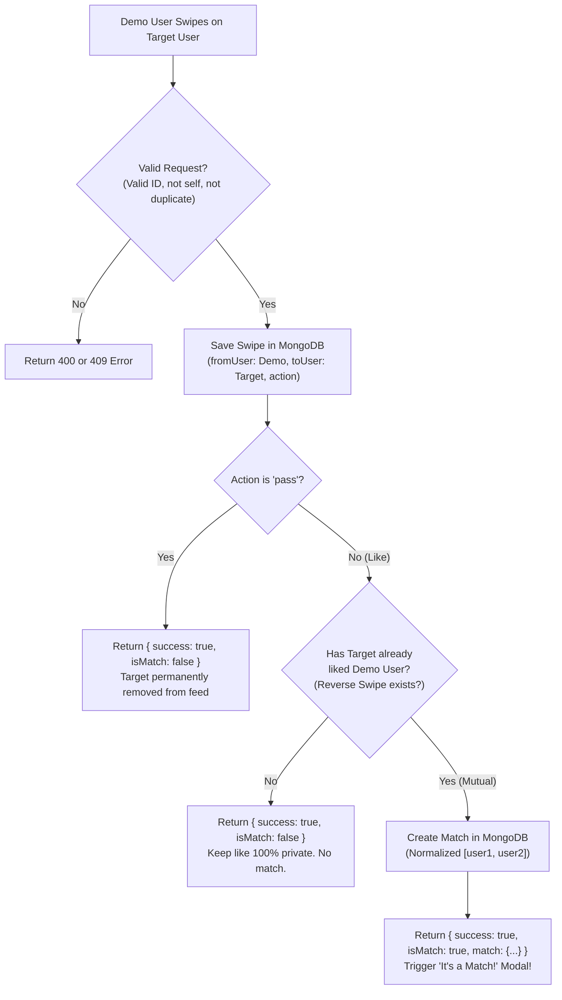

# Coy Discover 💖 — Privacy-First Discovery & Matching Experience

> A standalone full-stack implementation of Coy's new **Discover** experience inspired by Tinder and Bumble, engineered with strict **mutual-only privacy principles**, clean neo-brutalist visual design, and robust REST APIs.

---

## 📖 Table of Contents
1. [Project Overview](#-project-overview)
2. [Core Privacy Principle](#-core-privacy-principle)
3. [Features](#-features)
4. [Technology Stack](#-technology-stack)
5. [Application Architecture](#-application-architecture)
6. [Folder Structure](#-folder-structure)
7. [Database Schemas](#-database-schemas)
8. [Matching Algorithm & Privacy Engine](#-matching-algorithm--privacy-engine)
9. [REST API Documentation](#-rest-api-documentation)
10. [Design System & Visual Identity](#-design-system--visual-identity)
11. [Installation & Setup](#-installation--setup)
12. [Environment Variables](#-environment-variables)
13. [Database Seeding](#-database-seeding)
14. [Running the Application](#-running-the-application)
15. [Automated Testing Suite](#-automated-testing-suite)
16. [Deployment Guide](#-deployment-guide)

---

## 🌟 Project Overview

**Coy** is a consumer application designed around psychological safety and privacy. It lets people discover whether someone they are interested in likes them back — without the anxiety, vulnerability, or exposure of unreciprocated likes.

This project delivers the **Discover** feature as an autonomous, production-ready full-stack application:
- A responsive card deck with **touch drag gestures** and **desktop action buttons**.
- **Mutual-only matching engine** where incoming likes remain 100% confidential.
- Real-time **Match Celebration Modal** with dual avatars and confetti.
- **Matches gallery** displaying only verified mutual connections.
- Persistent state backed by **MongoDB & Mongoose**.

---

## 🔒 Core Privacy Principle

> **"Users must NEVER know who has liked them unless they have liked that person back. Only mutual likes result in a match."**

How this is enforced across the stack:
1. **Feed Isolation (`GET /feed`)**: Profiles in the feed never indicate whether that person has liked the user. Incoming swipe records are excluded from API payloads, response objects, and database lookups for the feed.
2. **One-Way Swipe Privacy (`POST /swipe`)**: If user A likes user B, but user B has not liked user A, the response is `{ success: true, isMatch: false }`. It never hints at future or pending actions.
3. **Pass Privacy**: Passing a profile permanently removes it from the feed. Even if that profile previously liked the user, passing them ensures no match is formed and no indication is ever leaked.
4. **Matches Integrity (`GET /matches`)**: The Matches endpoint queries only pairs with verified mutual likes. One-sided incoming likes are strictly excluded.

---

## ✨ Features

- **Gesture-Driven Swiping**: Drag cards right to Like, left to Pass using **Framer Motion** with dynamic rotation, elastic resistance, and animated `LIKE` and `PASS` stamps.
- **Desktop Friendly**: Prominent circular action buttons with Coy Pink heart and contrasting Pass icon, with keyboard and mouse drag support.
- **Deck Layering**: Realistic card stack with background card preview and smooth exit animations.
- **Celebration Modal**: Fullscreen/modal celebration featuring both user profile photos, overlapping heart badge, and confetti burst via `canvas-confetti`.
- **Matches Page**: Dedicated gallery displaying mutual matches with profile details, bio, tags, and "Say Hi" action.
- **Fixed Demo User (`Deepanshu Tripathi`, ID: `65f000000000000000000001`)**: No auth barrier required for testing.
- **Pre-Seeded Hidden Incoming Likes**: 8 realistic mock profiles are pre-configured to like the demo user so matches can be demonstrated immediately.
- **One-Click Demo Reset**: Reset demo swipes and matches back to clean state from the navbar without losing mock seed data.
- **Image Fallback System**: Graceful avatar initial fallbacks if Unsplash images encounter network latency.

---

## 🛠️ Technology Stack

| Layer | Technologies |
|---|---|
| **Frontend** | React 18 (JavaScript ES6+), Vite, React Router DOM v7, Tailwind CSS, Framer Motion, Axios, Lucide React, React Hot Toast, Canvas Confetti |
| **Backend** | Node.js (v22+), Express.js (v4.21+), Mongoose ODM (v8.9+), Morgan, CORS, Dotenv |
| **Database** | MongoDB Atlas / Local MongoDB 8.0 |
| **Testing** | Node Test Runner (`node:test`, `node:assert`), in-process HTTP client |

---

## 📐 Application Architecture

```
┌────────────────────────────────────────────────────────┐
│                   React + Vite Client                  │
│  (Navbar / BottomNav, Discover Deck, Matches, Modal)   │
└───────────────────────────┬────────────────────────────┘
                            │ Axios REST Calls (/api/*)
                            ▼
┌────────────────────────────────────────────────────────┐
│                   Express.js Backend                   │
│   ┌───────────────┬─────────────────┬──────────────┐   │
│   │  /feed Route  │  /swipe Route   │ /matches Rte │   │
│   └───────┬───────┴────────┬────────┴──────┬───────┘   │
│           │                │               │           │
│           ▼                ▼               ▼           │
│   FeedController    SwipeController  MatchController   │
│           │                │               │           │
│           └────────────────┼───────────────┘           │
│                            ▼                           │
│                 Mongoose ODM Models                    │
│             (User, Swipe, Match Schemas)               │
└────────────────────────────┬───────────────────────────┘
                             │
                             ▼
┌────────────────────────────────────────────────────────┐
│                  MongoDB Database                      │
│        Collections: `users`, `swipes`, `matches`       │
└────────────────────────────────────────────────────────┘
```

---

## 📁 Folder Structure

```
coy-discover/
├── client/                         # Frontend React + Vite SPA
│   ├── public/
│   │   └── favicon.svg             # Coy pink heart favicon
│   ├── src/
│   │   ├── components/
│   │   │   ├── BottomNav.jsx       # Mobile bottom navigation bar
│   │   │   ├── EmptyState.jsx      # Catch-up & empty matches states
│   │   │   ├── MatchCard.jsx       # Mutual match tile in Matches tab
│   │   │   ├── MatchModal.jsx      # It's a Match! celebration modal
│   │   │   ├── Navbar.jsx          # Desktop sticky header with reset demo
│   │   │   ├── ProfileCard.jsx     # Framer motion draggable swipe card
│   │   │   ├── ProfileInterests.jsx# Pill tags for interests
│   │   │   └── SwipeButtons.jsx    # Circular PASS (X) and LIKE (Heart) buttons
│   │   ├── hooks/
│   │   │   ├── useFeed.js          # Feed state and card deck pagination
│   │   │   └── useSwipe.js         # Swipe handler with match detection
│   │   ├── pages/
│   │   │   ├── Discover.jsx        # Primary swipe card deck feature
│   │   │   ├── Home.jsx            # Minimal blank placeholder
│   │   │   └── Matches.jsx         # Mutual matches gallery
│   │   ├── services/
│   │   │   └── api.js              # Axios API service
│   │   ├── App.jsx                 # Routing and layout container
│   │   ├── index.css               # Tailwind & custom neo-brutalist styles
│   │   └── main.jsx                # React DOM entry point
│   ├── .env.example
│   ├── index.html
│   ├── package.json
│   ├── postcss.config.js
│   ├── tailwind.config.js
│   └── vite.config.js
├── server/                         # Backend Express REST API
│   ├── config/
│   │   ├── constants.js            # Fixed demo user constants
│   │   └── db.js                   # Mongoose connection & disconnect helpers
│   ├── controllers/
│   │   ├── feedController.js       # GET /feed logic excluding swiped users
│   │   ├── matchController.js      # GET /matches, GET /me, POST /reset
│   │   └── swipeController.js      # POST /swipe mutual matching logic
│   ├── middleware/
│   │   └── errorHandler.js         # Centralized error handler & status codes
│   ├── models/
│   │   ├── Match.js                # Normalized mutual match schema
│   │   ├── Swipe.js                # Swipe schema with compound unique index
│   │   └── User.js                 # Profile schema with validation
│   ├── routes/
│   │   ├── feedRoutes.js           # Feed router
│   │   ├── matchRoutes.js          # Match router
│   │   └── swipeRoutes.js          # Swipe router
│   ├── seed/
│   │   ├── seed.js                 # Idempotent database seeder
│   │   └── seedData.js             # 32 Indian mock profiles + demo user
│   ├── tests/
│   │   └── api.test.js             # 10 integration and privacy test cases
│   ├── .env.example
│   ├── package.json
│   └── server.js                   # Express server entry point
├── .gitignore                      # Git ignore rules
├── package.json                    # Root scripts for running server + client
└── README.md                       # Complete documentation
```

---

## 🗄️ Database Schemas

### 1. `User` Schema
```javascript
{
  name: { type: String, required: true, trim: true },
  age: { type: Number, required: true, min: 18, max: 100 },
  photo: { type: String, required: true },
  bio: { type: String, default: '' },
  city: { type: String, default: '' },
  college: { type: String, default: '' },
  interests: [{ type: String }],
  createdAt: { type: Date, default: Date.now },
  updatedAt: { type: Date, default: Date.now }
}
```

### 2. `Swipe` Schema
```javascript
{
  fromUser: { type: ObjectId, ref: 'User', required: true, index: true },
  toUser: { type: ObjectId, ref: 'User', required: true, index: true },
  action: { type: String, enum: ['like', 'pass'], required: true },
  createdAt: { type: Date, default: Date.now }
}
// Compound unique index prevents multiple swipes by the same user on the same profile:
swipeSchema.index({ fromUser: 1, toUser: 1 }, { unique: true });
```

### 3. `Match` Schema
```javascript
{
  user1: { type: ObjectId, ref: 'User', required: true, index: true },
  user2: { type: ObjectId, ref: 'User', required: true, index: true },
  createdAt: { type: Date, default: Date.now }
}
// Unique compound index:
matchSchema.index({ user1: 1, user2: 1 }, { unique: true });
```
> **Pair Normalization**: Prior to validation/saving, `user1` and `user2` IDs are sorted alphabetically (`user1 < user2`). This guarantees no duplicate match can ever exist regardless of who swiped first.

---

## 🤝 Matching Algorithm & Privacy Engine



---

## 📡 REST API Documentation

### 1. `GET /feed` (or `GET /api/feed`)
Returns unswiped candidate profiles for the demo user.
- **Excludes**: Profiles already swiped (`like` or `pass`), and the demo user's own profile.
- **Privacy Guarantee**: Does NOT include any incoming like or swipe indicators.

**Response `200 OK`**:
```json
{
  "success": true,
  "count": 32,
  "profiles": [
    {
      "_id": "673f8a000000000000000002",
      "name": "Ananya Verma",
      "age": 22,
      "photo": "https://images.unsplash.com/photo-1534528741775-53994a69daeb",
      "bio": "Art director in the making. Film enthusiast, chai lover, and weekend cafe hopper.",
      "city": "Delhi",
      "college": "Delhi University",
      "interests": ["Photography", "Cinema", "Chai", "Art"]
    }
  ]
}
```

---

### 2. `POST /swipe` (or `POST /api/swipe`)
Records a swipe and checks for a mutual match.

**Request Body**:
```json
{
  "targetUserId": "673f8a000000000000000002",
  "action": "like"
}
```

**Response `200 OK` (No Match / One-sided Like or Pass)**:
```json
{
  "success": true,
  "isMatch": false,
  "message": "Swipe recorded successfully"
}
```

**Response `200 OK` (Mutual Match)**:
```json
{
  "success": true,
  "isMatch": true,
  "match": {
    "_id": "673f8b000000000000000099",
    "user": {
      "_id": "673f8a000000000000000002",
      "name": "Ananya Verma",
      "age": 22,
      "photo": "https://images.unsplash.com/photo-1534528741775-53994a69daeb",
      "bio": "Art director in the making...",
      "city": "Delhi",
      "college": "Delhi University",
      "interests": ["Photography", "Cinema", "Chai", "Art"]
    }
  }
}
```

**Error Responses**:
- `400 Bad Request`: Invalid ID format, swiping on self, or action is not `like`/`pass`.
- `404 Not Found`: Target user does not exist.
- `409 Conflict`: Already swiped on this profile.

---

### 3. `GET /matches` (or `GET /api/matches`)
Returns all mutual matches for the demo user with populated partner profiles.

**Response `200 OK`**:
```json
{
  "success": true,
  "count": 1,
  "matches": [
    {
      "matchId": "673f8b000000000000000099",
      "_id": "673f8a000000000000000002",
      "name": "Ananya Verma",
      "age": 22,
      "photo": "https://images.unsplash.com/photo-1534528741775-53994a69daeb",
      "bio": "Art director in the making...",
      "city": "Delhi",
      "college": "Delhi University",
      "interests": ["Photography", "Cinema", "Chai", "Art"],
      "matchedAt": "2026-11-19T14:15:00.000Z"
    }
  ]
}
```

---

### 4. `POST /reset` (or `POST /api/reset`)
Helper endpoint for testing: Clears demo user's outgoing swipes and mutual matches, keeping mock profiles and their hidden incoming likes intact for repeat demonstrations.

---

## 🎨 Design System & Visual Identity

The UI incorporates Coy's branding personality: friendly, clean, and neo-brutalist pop.

| Element | Hex Code / Specification | Usage |
|---|---|---|
| **Primary Coy Pink** | `#FF347F` | Like button, hearts, match celebration, active tab |
| **Soft Lavender** | `#E9E0FF` | Interest pill tags, avatar backdrops, secondary badges |
| **Light Lavender** | `#F5F2FA` | Main body surface, subtle cards |
| **Primary Text** | `#191722` | Bold titles, high-contrast typography, dark borders |
| **Secondary Text** | `#85818F` | Captions, subtitles, inactive nav |
| **Light Border** | `#EAE6F0` | Dividers and subtle boundaries |
| **Offset Shadow** | `4px 4px 0px #191722` | Cards, buttons, badges |
| **Typography** | `Plus Jakarta Sans` | Modern geometric sans-serif |

---

## 🚀 Installation & Setup

### Prerequisites
- **Node.js** v18+ (tested on Node v22.14.0)
- **MongoDB** running locally (`localhost:27017`) or a free [MongoDB Atlas Cluster](https://www.mongodb.com/atlas)

### 1. Clone the Repository
```bash
git clone https://github.com/your-username/coy-discover.git
cd coy-discover
```

### 2. Install Dependencies
You can install dependencies from root:
```bash
npm run install:all
```
Or manually inside each folder:
```bash
cd server && npm install
cd ../client && npm install
```

---

## 🔑 Environment Variables

### Backend (`server/.env`)
Create a `.env` file in the `server` directory (or copy from `.env.example`):
```env
PORT=5000
MONGODB_URI=mongodb://localhost:27017/coy-discover
CLIENT_URL=http://localhost:5173
DEMO_USER_ID=65f000000000000000000001
```

> **For MongoDB Atlas**: Replace `MONGODB_URI` with your connection string:
> `mongodb+srv://<username>:<password>@cluster0.mongodb.net/coy-discover?retryWrites=true&w=majority`

### Frontend (`client/.env`)
Create a `.env` file in the `client` directory:
```env
VITE_API_BASE_URL=http://localhost:5000/api
```

---

## 🌱 Database Seeding

Seed 32 realistic mock user profiles and 8 hidden incoming likes to the fixed demo user:

```bash
npm run seed
```
*(Or inside `/server`: `node seed/seed.js`)*

Profiles include realistic Indian names (Ananya, Aarav, Rhea, Kabir, Diya, Rohan, etc.) across Delhi, Gurgaon, Noida, and colleges like MAIT, DTU, NSUT, DU, and IIT Delhi.

---

## 💻 Running the Application

### Option A: Run Both Together from Root
Open two terminal windows:

**Terminal 1 (Backend Server):**
```bash
npm run server
```
Server starts on `http://localhost:5000`.

**Terminal 2 (Frontend Client):**
```bash
npm run client
```
Client starts on `http://localhost:5173`.

---

### Option B: Run Individually

**Backend:**
```bash
cd server
npm start
```

**Frontend:**
```bash
cd client
npm run dev
```

Visit **`http://localhost:5173`** in your browser. The app opens directly to the **Discover** tab!

---

## 🧪 Automated Testing Suite

The backend includes a 10-point test suite validating all functional and privacy specifications:

```bash
npm run test:backend
```

### Verified Test Cases:
1. `GET /feed` returns eligible profiles excluding demo user.
2. **PRIVACY CHECK**: Feed NEVER reveals incoming like status or private swipe metadata.
3. Liking a profile that has NOT liked demo user records swipe, creates no match, and removes profile from feed.
4. Passing a profile records pass, creates no match, and removes profile permanently.
5. Liking a profile that HAS liked demo user triggers an immediate mutual match.
6. Duplicate swipe attempts on the same profile are rejected with `409 Conflict`.
7. Swiping on demo user's own profile is rejected with `400 Bad Request`.
8. Invalid actions (e.g., `superlike`) are rejected with `400 Bad Request`.
9. `GET /matches` returns ONLY mutual matches and NEVER unreciprocated incoming likes.
10. Feed maintains exclusions across simulated browser reloads.

---

## ☁️ Deployment Guide

### Backend on Render / Railway
1. Push repository to GitHub.
2. In Render, create a **New Web Service** pointing to the repository.
3. Configure settings:
   - **Root Directory**: `server`
   - **Build Command**: `npm install`
   - **Start Command**: `node server.js`
4. Set Environment Variables:
   - `PORT`: `5000`
   - `MONGODB_URI`: `<Your MongoDB Atlas Connection String>`
   - `CLIENT_URL`: `<Your Vercel Frontend URL>`
   - `DEMO_USER_ID`: `65f000000000000000000001`

### Frontend on Vercel
1. In Vercel, import the GitHub repository.
2. Configure settings:
   - **Framework Preset**: `Vite`
   - **Root Directory**: `client`
   - **Build Command**: `npm run build`
   - **Output Directory**: `dist`
3. Add Environment Variable:
   - `VITE_API_BASE_URL`: `https://your-backend-service.onrender.com/api`
4. Deploy!

---

## 📄 License
ISC License • Built for the Coy SDE Assignment.
